# ghstats

<div align="center">

🤩📈 Self-hosted GitHub traffic analytics with long-term history, SQLite storage,
and a tiny Docker image.

[](https://github.com/vladkens/ghstats/releases)
[](https://github.com/vladkens/ghstats/blob/main/LICENSE)
[](https://buymeacoffee.com/vladkens)

</div>

<div align="center">
  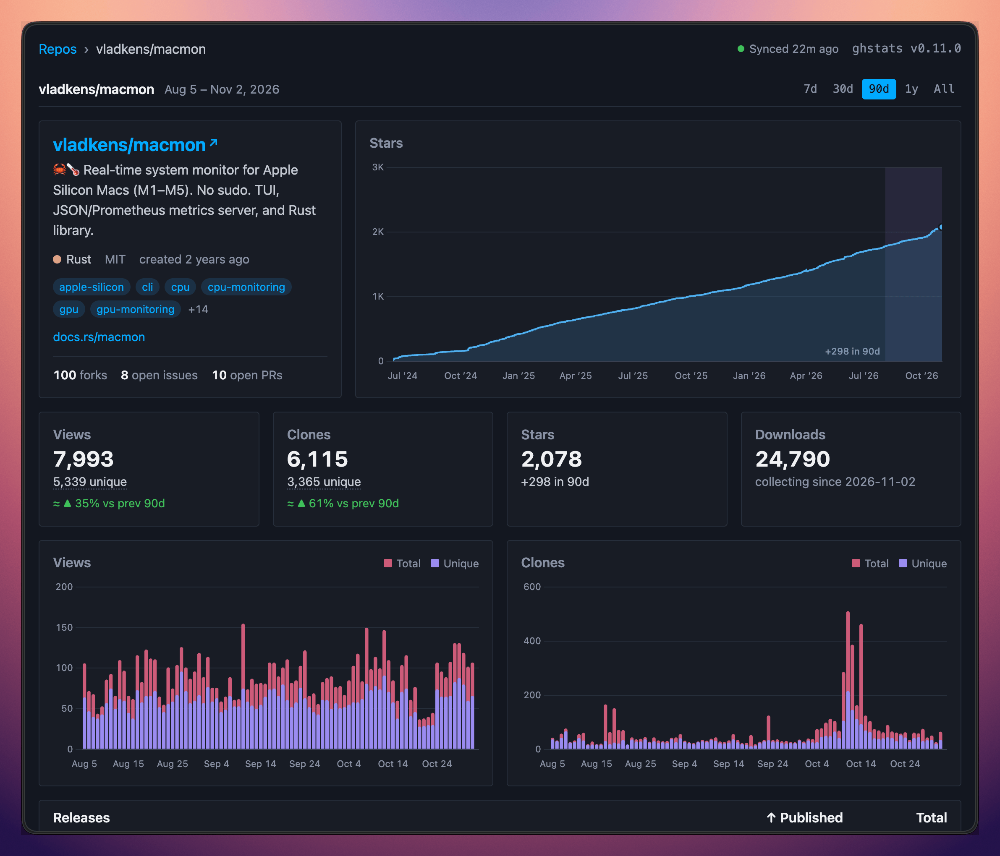
</div>

GitHub only keeps repository traffic data for 14 days. `ghstats` continuously
pulls that data from the GitHub API and keeps your own history of views, clones,
stars, forks, issues, and pull requests in a local SQLite database.

Use it for personal projects, open-source portfolios, organization dashboards,
or public stats pages where GitHub's built-in traffic tab is too short-lived.

## Features

- Long-term history for GitHub repository traffic beyond the 14-day GitHub limit
- Per-repository dashboards for stars, clones, views, referrers, and popular paths
- Automatic hourly sync for public repos, with optional private repo support
- Repo filtering by owner, exact name, forks, and archived status
- JSON API for exposing collected stats to personal sites or other tools
- Embeddable SVG badges for repository, portfolio, and service metrics
- Embeddable SVG cards with your top repositories and account totals
- Small self-hosted deployment: one Rust binary, one SQLite database, one Docker image

## Quick start

```sh
docker run -d --env-file .env -p 8080:8080 -v ./data:/app/data --name ghstats ghcr.io/vladkens/ghstats:latest
```

Open http://127.0.0.1:8080 after the container starts.

Note: ghstats Docker images run as a non-root user. If you upgrade an existing
installation and the container cannot write to SQLite, fix the mounted data
directory ownership once:

```sh
docker run --rm -u root -v ./data:/app/data ghcr.io/vladkens/ghstats:latest chown -R appuser:appgroup /app/data
```

Docker Compose:

```yaml
services:
  ghstats:
    image: ghcr.io/vladkens/ghstats:latest
    container_name: ghstats
    restart: always
    environment:
      - GITHUB_TOKEN=???
    env_file: .env # or with .env file
    ports:
      - 8080:8080
    volumes:
      - ./data:/app/data
```

The database is stored in `/app/data/ghstats.db` (`DB_PATH` changes it).

## Why ghstats?

- **Own your history**: keep traffic data for months or years instead of losing it
  after two weeks.
- **Keep the setup boring**: no Postgres, no hosted account, no frontend build
  pipeline in production.
- **Publish only what you want**: filter repositories, hide forks or archived
  projects, and expose a read-only dashboard or API.

### Build locally with Docker Compose

This repository includes a `compose.yml` that builds the local `Dockerfile`, loads variables from `.env`, and stores SQLite data in a Docker named volume.

```sh
docker compose up --build -d
```

By default, the local compose setup exposes the app at http://127.0.0.1:8080. You can change the host port with `HOST_PORT` in `.env`.

### Github token generation

`ghstats` needs Github Token to collect traffic data from API. Token can be obtained with following steps:

1. Go to https://github.com/settings/tokens
2. Generate new token > Generate new token (classic)
3. Enter name, e.g.: `ghstats`. Scopes: `public_repo`
4. Click genereate token & copy it
5. Save token to `.env` file with name `GITHUB_TOKEN=ghp_XXX`

Note: If you want to access private repos too, choose full `repo` scope and set `GHS_INCLUDE_PRIVATE=true` to env.

### Rotating GitHub installation token

Set `GITHUB_TOKEN_FILE` when another process, such as [External Secrets Operator](https://external-secrets.io/latest/api/generator/github/), creates and rotates a short-lived `ghs_` installation token:

```yaml
environment:
  GITHUB_TOKEN_FILE: /run/secrets/ghstats/github-token
volumes:
  - ./secrets:/run/secrets/ghstats:ro
```

The file is read before every GitHub API request, including every pagination request, and takes precedence over `GITHUB_TOKEN`. A rotated token therefore takes effect without restarting `ghstats`. Installation tokens use the `/installation/repositories` endpoint automatically. In Kubernetes, mount the Secret as a volume and do not use `subPath`, because `subPath` mounts do not receive Secret updates.

## How it works?

Every hour `ghstats` loads the list of public repositories and their statistics, and saves the data in SQLite. If at the first startup there is no repositories in the database, synchronization will happen immediately, if `ghstats` is restarted again, synchronization will be performed according to the scheduler. Data is stored per day, re-fetching data for the current day will update existing records in the database. Release asset download counts are saved as a daily snapshot of GitHub's cumulative totals, refreshed on every sync (one extra request per repository, plus one per additional 100 releases), so download history starts from the first sync.

All public repositories that can be accessed are saved. If you need more detailed configuration – open PR please.

The web UI has no external dependencies at runtime: frontend libraries (Chart.js, Luxon, htmx) are committed to `assets/vendor` and embedded into the binary, so pages work offline and do not load anything from a CDN. `make vendor` refreshes them to the latest release of each library's major version.

## Configuration

### Host & Port

You can to change default host / port app will run on with `HOST` (default `0.0.0.0`) and `PORT` (default `8080`) environment variables.

### Metrics schedule

You can change how often metrics are pulled with the `GHS_CRON_SCHEDULE` environment variable. It uses the six-field cron format from `tokio-cron-scheduler`. The default is `0 59 * * * *`, which runs at minute 59 of every hour.

For example, to pull metrics once per day at 00:59:

```sh
GHS_CRON_SCHEDULE="0 59 0 * * *"
```

### Custom links

If you plan to display your stats publicly, there is an option to add custom links to the header via environment variables, e.g.:

```sh
GHS_CUSTOM_LINKS="Blog|https://medium.com/@vladkens,Github|https://github.com/vladkens,Buy me a coffee|https://buymeacoffee.com/vladkens"
```

### Version check

By default, `ghstats` asks GitHub for the latest `ghstats` release on the metrics schedule (hourly by default) and shows a notice in the UI when a newer one is available. Set `GHS_DISABLE_VERSION_CHECK=true` to turn this request off.

### Default sort

The home page is sorted by views by default. Set `GHS_SORT` to another column to change that, e.g. `GHS_SORT=stars`. The values are the `sort` keys of the home page URL: `stars`, `forks`, `issues`, `prs`, `views_count`, `clones_count`, `downloads`. Sorting by a column header still works as before.

### Filtering

Two variables pick the repos, both written in one query syntax like GitHub search:

- `GHS_FILTER` picks the repos `ghstats` collects and shows anywhere (pages, API, badges, cards); repos outside it aren't synced, and the stats they already have stay in the database, hidden
- `GHS_SHOW` picks which of the collected repos are shown on the public pages: the rest are hidden from the home list, their repo pages (a hidden repo's page is a 404) and the cards, while their data is still collected and badges and the API are unchanged

```sh
GHS_FILTER='vladkens/*' # only vladkens repos
GHS_FILTER='vladkens/macmon OR vladkens/ghstats' # only these two repos
GHS_FILTER='vladkens/* OR foo-org/bar' # vladkens repos and one repo from `foo-org`
GHS_FILTER='vladkens/* !vladkens/apigen-ts' # vladkens repos except `apigen-ts`
GHS_FILTER='!vladkens/apigen-ts !foo-org/bar' # all repos except two
GHS_FILTER='!fork' # all repos except forks
GHS_FILTER='vladkens/* !fork' # vladkens repos except forks
GHS_FILTER='!fork OR vladkens/some-fork' # all repos except forks, but keep `some-fork`
GHS_FILTER='!fork !archived' # all repos except forks and archived

GHS_SHOW='stars:>=25 OR age:<3m' # 25+ stars or created in the last 3 months
GHS_SHOW='(stars:>=25 OR age:<3m) !fork' # the same without forks
GHS_SHOW='stars:>=25 OR vladkens/wavo' # and always show `wavo`
GHS_SHOW='vladkens/* stars:10..100' # vladkens repos with 10 to 100 stars
```

The syntax:

- A term is `field:value`; a word without `field:` matches the repo name, so `vladkens/*` is `repo:vladkens/*`, except the words `fork` and `archived` (any case), which are `fork:true` and `archived:true`, so `!fork` drops forks
- Numbers and durations take `25`, `>25`, `>=25`, `<25`, `<=25` and inclusive ranges `10..50`, `10..*`, `*..50`; numbers may end in `k` (`1.5k` is 1500) and take no thousands separators: write `1k` or `1000`
- Durations are `90d`, `2w`, `3m` (30 days each) or `1y` (365 days)
- Terms separated by spaces or `AND` must all match; `OR` (uppercase) matches either side; `!` negates a term or a group; `( ... )` groups
- `!` binds tightest, then AND, then OR: `a OR b c` is `a OR (b c)`
- Empty means all repos; an invalid value is logged as an error at startup and the variable is ignored

| Field | Value | Example |
| --- | --- | --- |
| `repo` | `owner/name` with `*` wildcards on either side, any case; a value without exactly one `/` like `vladkens` is an error | `repo:vladkens/*`, `*/ghstats` |
| `fork`, `archived` | `true` or `false` | `fork:false` |
| `stars`, `forks`, `issues`, `prs` (`GHS_SHOW` only) | current count | `stars:>=1k` |
| `age` (`GHS_SHOW` only) | time since the repo was created on GitHub (unknown until the next sync, then terms on it don't match) | `age:<3m` |

Old comma values of `GHS_FILTER` like `!fork,vladkens/*` keep working, with two deliberate improvements: globs like `vladkens/apigen-*` work (the old rules took only `owner/*`), and a list of only `!owner/repo` excludes means all repos except them (before it collected nothing).

### Health endpoint

`/health` reports the service state in JSON and needs no token:

```json
{
  "status": "ok",
  "sync_healthy": true,
  "sync_last_success": "2026-11-06T04:59:12Z",
  "sync_last_error": null,
  "sync_running": false
}
```

`sync_healthy` is `true` if the last successful sync was less than 8 hours ago, which is 8 missed runs on the default hourly schedule. `sync_last_success` is kept in memory and is empty after a restart, so with no successful sync yet `sync_healthy` is `true` during the first 8 hours of uptime, then `false`. The 8 hours are fixed, so a `GHS_CRON_SCHEDULE` rarer than that reads as unhealthy between runs. `sync_last_error` is the error of the last failed sync, `null` once a sync succeeds.

The HTTP code reflects only the database: `200` with `"status": "ok"`, or `503` with `"status": "error"` and the details if it isn't writable. A stale sync doesn't change it: Docker's `HEALTHCHECK` reads this endpoint, and a stale sync shouldn't mark the container unhealthy, because a restart doesn't fix an expired token.

### API endpoint

You have the ability to get collected data by `ghstats` via API. At the moment there is only one method available to get all repos list – if you need other data – open PR, please. `GHS_API_TOKEN` environment variable must be set for the API to work. All API calls if protected by `x-api-token` header, which should be same with `GHS_API_TOKEN` variable. CORS is enabled for all hosts, so you can access API from personal pages.

#### Endpoints

`/api/repos` – will return list of all repos and overall metrics. Data returted in JSON format. Usage example:

```sh
curl -H "x-api-token:1234" http://127.0.0.1:8080/api/repos
```

```jsonc
{
  "total_count": 20,
  "total_stars": 1000,
  "total_forks": 200,
  "total_views": 20000,
  "total_clones": 500,
  "items": [
    {
      "id": 833875266,
      "name": "vladkens/ghstats",
      "description": "🤩📈 Self-hosted dashboard for tracking GitHub repos traffic history longer than 14 days.",
      "date": "2024-09-08T00:00:00Z",
      "stars": 110,
      "forks": 1,
      "watchers": 110,
      "issues": 5,
      "prs": 1,
      "clones_count": 90,
      "clones_uniques": 45,
      "views_count": 1726,
      "views_uniques": 659,
    },
    // ...
  ],
}
```

### Badge endpoints

`ghstats` can render the collected statistics as SVG badges for GitHub READMEs, personal websites, and dashboards. Badge endpoints are public and use the same `GHS_FILTER` rules as the HTML dashboard.

Repository badges use `/badge/{owner}/{repo}/{metric}.svg`:

| Metric        | Example endpoint                             | Default period  |
| ------------- | -------------------------------------------- | --------------- |
| Views         | `/badge/vladkens/ghstats/views.svg`          | Tracked history |
| Clones        | `/badge/vladkens/ghstats/clones.svg`         | Tracked history |
| Stars         | `/badge/vladkens/ghstats/stars.svg`          | Current value   |
| Star growth   | `/badge/vladkens/ghstats/stars-growth.svg`   | 30 days         |
| Star velocity | `/badge/vladkens/ghstats/stars-velocity.svg` | 30 days         |
| Traffic peak  | `/badge/vladkens/ghstats/traffic-peak.svg`   | 30 days         |

Omit the owner and repository to aggregate a metric across all repositories allowed by `GHS_FILTER`:

```text
/badge/views.svg
/badge/clones.svg
/badge/stars.svg
/badge/stars-growth.svg
/badge/stars-velocity.svg
/badge/traffic-peak.svg
/badge/repos.svg
```

Views and clones accept `period=7d`, `period=30d`, `period=90d`, `period=1y`, or `period=tracked`. Star growth, star velocity, and traffic peak accept the same values and default to `30d`.

```text
/badge/vladkens/ghstats/views.svg?period=30d
/badge/stars-growth.svg?period=90d
```

`tracked` means the history retained since `ghstats` started observing a repository, not necessarily the repository's complete lifetime. Star velocity is the average net star change per observed day, and traffic peak is the largest daily view count in the selected period.

Global service badges expose the application health, the latest successful metrics sync, and the age of the earliest retained metric:

```text
/badge/health.svg
/badge/updated.svg
/badge/tracking.svg
```

Markdown example:

```md
[](https://ghstats.example.com/vladkens/ghstats)
```

Badge URLs cannot send `GHS_API_TOKEN`. If the instance contains private repository data, protect the instance with a reverse proxy or exclude those repositories with `GHS_FILTER` before publishing badge URLs.

### Card endpoints

`ghstats` can also render SVG cards for a GitHub profile README or a personal site:

| Card              | Endpoint                           | Shows                                                                            |
| ----------------- | ---------------------------------- | -------------------------------------------------------------------------------- |
| Top stars         | `/card/stars.svg`                  | Top 5 repositories by current stars, with the change in the period               |
| Top forks         | `/card/forks.svg`                  | Top 5 repositories by current forks, with the change in the period               |
| Top clones        | `/card/clones.svg`                 | Top 5 repositories by clones in the period                                       |
| Top views         | `/card/views.svg`                  | Top 5 repositories by views in the period                                        |
| Totals            | `/card/totals.svg`                 | Stars, forks, views, clones and repositories, with the change in the period      |
| Star history      | `/card/history.svg`                | Chart of the total stars of all repositories on the cards                        |
| Repo star history | `/card/{owner}/{repo}/history.svg` | Chart of the stars of one repository, a repository the cards can't show is a 404 |

Examples, rendered by a real instance and saved in [examples](examples):

<details>
<summary>Examples</summary>

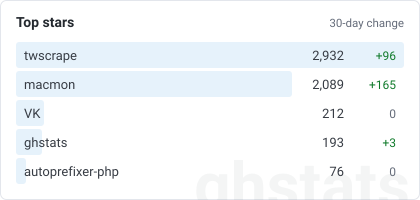 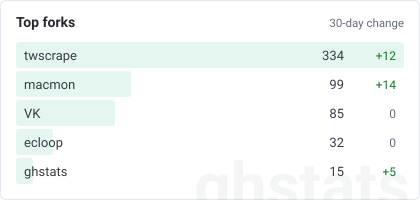

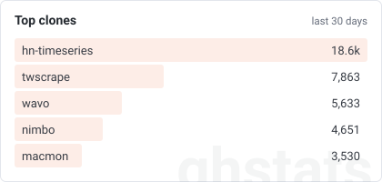 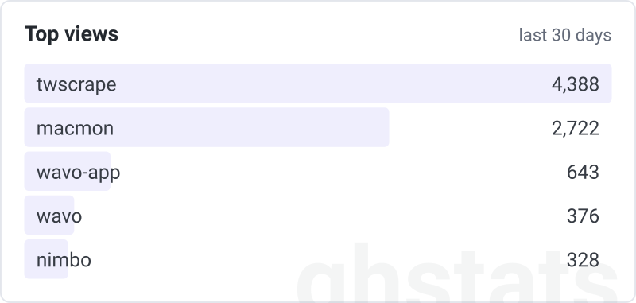

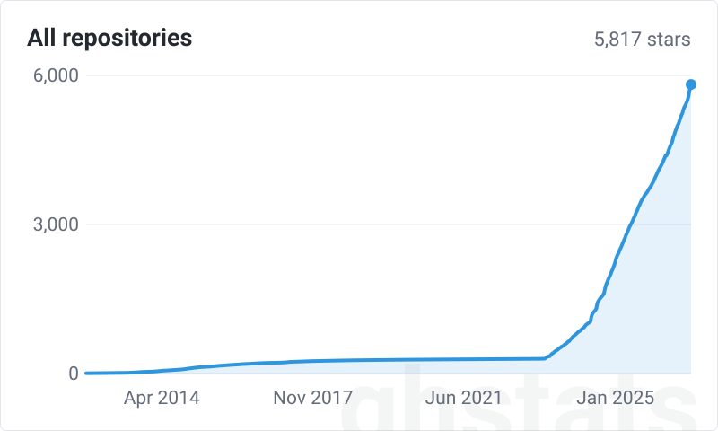 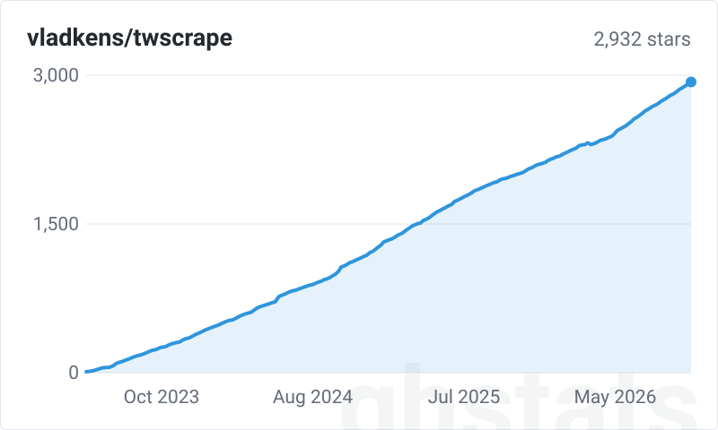

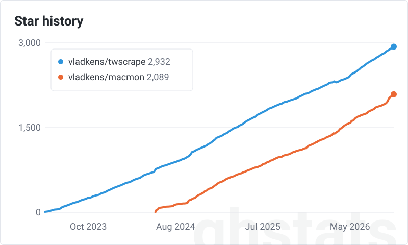 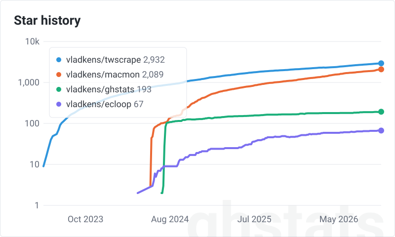

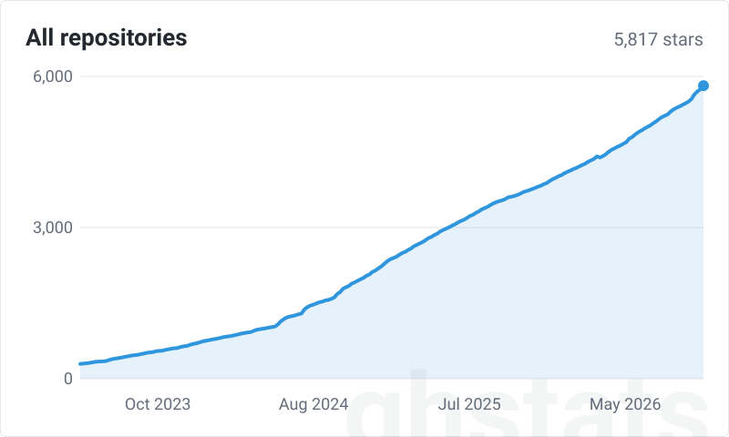

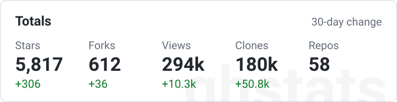

</details>

Query parameters:

- `period`: `7d`, `30d` (default), `90d`, `1y` or `tracked`, as for badges. With `tracked` the top lists use all collected history and no change is shown. The star history cards default to `tracked`, the whole history
- `theme`: `auto` (default) follows the viewer's light or dark mode, `light` and `dark` fix the colors
- `brand`: `brand=1` (default) keeps the `ghstats` wordmark in the background, `brand=0` removes it
- `log`: on the star history cards, `log=1` draws a log scale with gridlines at powers of ten and no area under a single line, `log=0` (default) keeps the linear one
- `repos`: on `/card/history.svg`, up to 4 comma-separated `owner/name` repositories, each as its own line with a legend. More than 4 is a 400 error, a repository the cards can't show is a 404
- `align`: with `repos`, `align=1` starts every line at its own first date and counts days or years on the x axis, to compare how fast projects grew from their start; `align=0` (default) keeps the dates
- `since`: on the star history cards, `since=2023-01-01` (`YYYY-MM-DD`) starts the chart at the first recorded date on or after it and replaces `period`, for a total that stays flat for years before growth starts

Any other value of `period`, `theme`, `brand`, `log`, `align` and `since` is a 400 error.

All cards are 800 wide by default. A smaller width in the embed makes them smaller, for example two in a row: ``.

Charts only know repositories `ghstats` tracks, so `repos` can't compare an arbitrary GitHub repository.

Cards are public and show repository names. They follow both `GHS_FILTER` and `GHS_SHOW` and never show private repositories, also with `GHS_INCLUDE_PRIVATE=true`: there is no option to include them, and the totals count the same set of repositories. Cards are cached for an hour.

GitHub loads images through its own proxy, so the server must be reachable from the internet for a card to show up in a README:

```md


```

## 🤝 Contributing

All contributions are welcome! Feel free to open an issue or submit a pull request.

## 🔍 See also

- [repohistory](https://github.com/repohistory/repohistory) – NodeJS application as a service.
- [gghstats](https://github.com/hrodrig/gghstats) – self-hosted Go application with SQLite.
